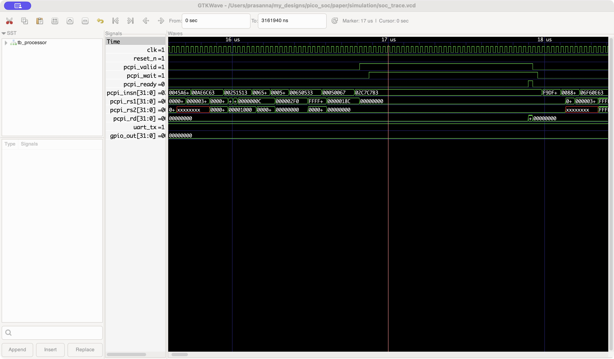
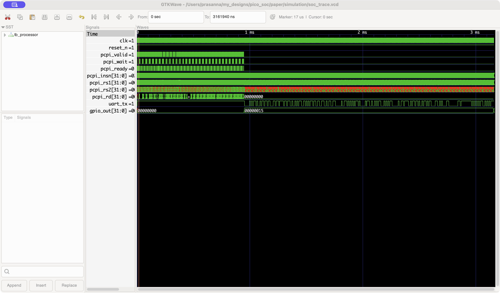

# PicoRV32 SoC RTL to GDS in SKY130

A hierarchical RV32IM system-on-chip with five hard macros: a reused PicoRV32 CPU, a standalone PCPI multiply/divide block, 4 KiB SRAM, GPIO and a transmit-only UART. The release contains the final physical views, Corsair register definitions and generated interfaces, firmware, testbenches, timing data and actual colour screenshots.

**Project period:** September-November 2026. **Released clock:** 30 ns / 33.333 MHz. **Process/library:** SKY130A / `sky130_fd_sc_hd`.

## Final GDS layout


This is an unedited screenshot of the final repaired `pico_soc.gds` opened in KLayout, with its original layer colours and visible application controls. Layer visibility can obscure internal detail; it does not alter the layout geometry.

## Architecture

```text
pico_soc
  processor        PicoRV32 CPU hard macro
  arithmetic_unit  standalone PCPI MUL/DIV hard macro
  D_mem_unit       1024 x 32 SRAM hard macro with byte-write enables
  gpio_unit        Corsair-generated GPIO register block hard macro
  uart_unit        Corsair register interface and TX-only UART hard macro
  parent logic     address decode, pending-request handshake and response mux
```

The arithmetic block is a separate RTL/synthesis/hardening boundary, not extracted from the CPU netlist or layout. It uses the PicoRV32 `picorv32_pcpi_fast_mul` and `picorv32_pcpi_div` helpers; this repository does not claim newly authored arithmetic algorithms. PCPI arithmetic is **not memory mapped**. Corsair generates the GPIO/UART register interfaces and C headers, not the CPU or arithmetic datapath.

| Target | Address / behavior |
| --- | --- |
| SRAM | `0x00000000-0x00000FFF`, 1024 x 32, four byte strobes |
| GPIO | High-nibble `0x4` decode; output register at offset `0x0`; LEDs alias bits `[4:0]` |
| UART | High-nibble `0x5` decode; DATA `0x0`, STATUS `0x4`, CONTROL `0x8` |
| UART status/control | READY bit 5, TX_DONE bit 13, START bit 9 |

CPU and UART use the same 33.333 MHz system clock. UART nominal baud is 115200; the implemented counter produces 291 clocks per bit, approximately 114547.54 bit/s. The physical SRAM includes a spare-column interface; the wrapper ties unused spare/address signals appropriately. Simulation uses a behavioral SRAM preload, not a silicon boot loader.

## Verified implementation results

| Metric | Final value |
| --- | ---: |
| Die dimensions | 1479.590 x 1769.335 um |
| Die / core area | 2.617890 / 2.564040 mm² |
| Target / achieved utilization | 40% / 41.5191% |
| Clock period | 30 ns |
| Worst setup slack across nine corners | +0.960839 ns |
| Worst hold slack across nine corners | +0.437495 ns |
| Setup / hold total negative slack | 0 / 0 ns |
| Slew / capacitance / fanout violations | 0 / 0 / 0 |
| Routed wire length | 436614 um |
| Non-fill instances / final DEF components | 22941 / 149697 |
| Merged-GDS KLayout DRC errors | 0 |
| Parent LVS errors | 0 |
| Routing DRC / antenna violations | 0 / 0 |
| Top-level 2W2S clock nets | 11 |

Clock NDRs apply only to parent clock routes: metal 3 and metal 4 width/spacing are 0.6/0.6 um, with nominal lower-layer pin access. Child macros do not receive this custom NDR. The CPU macro was reused; the SRAM repair was integrated while retaining the routed parent implementation. The achieved placement is not a proof of globally minimum area or wire length.

FF, TT and SS operate at 1.95 V/-40 C, 1.8 V/25 C and 1.6 V/100 C. Each combines with min/nom/max interconnect for nine STA corners. See [all timing corners](reports/nine_corner_timing.csv), [raw metrics](reports/all_reported_metrics.csv) and [qualification](reports/qualification.json).

### SRAM characterization

OpenRAM 1.2.49 and ngspice 45 characterize the repaired 4 KiB memory at three PVT corners and nine load/transition combinations per corner. Output loads are 1.7225, 6.89 and 27.56 fF; 10-90% input transitions are 0.032, 0.160 and 0.320 ns.

| Corner | Validated memory minimum period |
| --- | ---: |
| FF | 3.59375 ns |
| TT | 5.93750 ns |
| SS | 10.93750 ns |

These are memory-only characterization results, not a SoC maximum-frequency sweep. The final Liberty files, measurement points and qualification notes are included. The CPU-facing SRAM response can impose a half-cycle timing path.

## Actual simulation screenshots



PCPI valid/wait/ready and operand/result signals from the released gate-netlist simulation. Unknown values outside a valid transaction are visible rather than removed or redrawn.



The full-run view shows the arithmetic test phase followed by UART transmissions and GPIO activity. Both waveform images are actual, unedited GTKWave window captures in the application's original colours. The selected-signal VCD is supplied in `simulation/traces/soc_gate.vcd.gz`.

Functional checks pass **3202 standalone arithmetic cases**, including unsupported-opcode/reset recovery, and **256 CPU RV32M instructions**, SRAM word/byte writes, GPIO patterns and **22 UART frames**. The transmitted message is `PicoRV32 UART OK\r\n`, followed by bytes `00 FF 55 AA`. The SRAM test signature is `0xCDEFAB78`, and the final GPIO value is `0x600D0015`.

## Repository contents

```text
physical/
  config.json, run_soc.py          parent OpenLane flow and final configuration
  src/, scripts/                  parent RTL and top-only clock NDR scripts
  macros/                         only the released macro views
  final/                          final GDS, DEF, ODB, LEF, netlists, SPEF, SDF, Liberty, SDC
simulation/
  rtl/src/, regs/, firmware/      RTL, Corsair YAML/config and generated C headers
  rtl/tests/                     independent arithmetic vectors and unit test
  rtl/prebuilt/firmware.hex       firmware for running without a cross compiler
  gate/                          final-netlist testbench and behavioral SRAM
  traces/                        selected-signal gate VCD and GTKWave view
reports/                         final metrics, qualification and passing simulation logs
docs/images/                     original-colour application screenshots
tools/                           artifact unpacking and gate-simulation entry points
artifacts.json                   final artifact sizes and SHA-256 digests
```

Large physical files are stored with lossless compression. Most use gzip; the merged GDS uses xz. Compressed files above 4 MiB are split into numbered parts for reliable transfer. `tools/unpack_artifacts.py` rejoins those parts, checks the uncompressed SHA-256 and restores every original filename. This keeps individual uploads small without requiring Git LFS. Historical runs, compiler executables, PDK installations, caches, the paper and personal résumé are not part of the release.

## Tool stack and environment

| Purpose | Tools |
| --- | --- |
| Reproducible EDA shell | OpenLane2 Nix development shell |
| Synthesis / implementation / STA | Yosys, OpenROAD, OpenSTA via OpenLane2 |
| Technology | SKY130A PDK, `sky130_fd_sc_hd` standard cells |
| SRAM generation / characterization | OpenRAM 1.2.49, ngspice 45 |
| Physical verification | KLayout, Magic, Netgen |
| CSR generation | Corsair 1.0.4, Python |
| Functional simulation / viewing | Icarus Verilog, GTKWave 3.3.119 |
| Firmware | RISC-V GCC/objcopy, RV32IM with ILP32 ABI |

OpenLane2 source revision: `a7b0e6dba75ee7e891ff3d7824b29473d9cad289`.
Parent PDK revision: `0fe599b2afb6708d281543108caf8310912f54af`.
The SRAM originated from PDK revision `e8294524e5f67c533c5d0c3afa0bcc5b2a5fa066`; its final views and model qualifications are retained.

### Enter the OpenLane2 Nix shell

Install Nix and obtain the above OpenLane2 checkout following the [OpenLane2 documentation](https://openlane2.readthedocs.io/). Set the paths for your own machine:

```sh
git clone https://github.com/rishabht645/pico-soc-sky130.git
cd pico-soc-sky130
export OPENLANE_ROOT=/path/to/openlane2
export PDK_ROOT=/path/to/pdk/version-directory
nix-shell "$OPENLANE_ROOT/shell.nix"
```

`PDK_ROOT` must contain `sky130A/`, including the standard-cell functional Verilog models. The PDK and OpenLane2 installation are external dependencies, not included in this repository. Run the commands below from the repository root inside that Nix shell.

### Run RTL tests with the checked-in firmware

```sh
make -C simulation/rtl unit soc-prebuilt
```

This runs at the released 30 ns clock. Build outputs and selected-signal waveform files appear in `simulation/rtl/build/`. Expected final messages include `PASS: 3202 standalone PCPI arithmetic cases` and `PASS: 256 CPU RV32M operations ... 22 UART frames`.

### Rebuild the firmware and regenerate Corsair interfaces

With `riscv64-unknown-elf-gcc` and `riscv64-unknown-elf-objcopy` available:

```sh
make -C simulation/rtl vectors
make -C simulation/rtl sim
```

The checked-in generated peripheral RTL and headers allow simulation without Corsair. To regenerate them from the supplied register definitions, use the pinned requirements and the existing `regs` Make target:

```sh
python3 -m venv simulation/rtl/.venv
simulation/rtl/.venv/bin/pip install -r simulation/rtl/requirements.txt
make -C simulation/rtl regs
```

### Run the final gate-netlist simulation

```sh
bash tools/sim_gate.sh
```

The script restores only the required netlists, loads the PDK functional cells, and runs the released parent and child gate netlists. It produces `simulation/gate/build/soc_gate.vcd`. SRAM is behavioral, firmware is preloaded, and **no SDF is annotated**. Functional simulation is separate from static timing closure and transistor-level SRAM verification.

### Inspect the supplied trace and layout

```sh
python3 tools/unpack_artifacts.py
cd simulation/traces
gtkwave soc_gate.vcd pcpi.gtkw
```

From the repository root, open `physical/final/gds/pico_soc.gds` in KLayout. The top cell is `pico_soc`. The saved parent ODB and all three SPEF corners are available for implementation/timing inspection.

### Rebuild the parent physical design

```sh
python3 tools/unpack_artifacts.py
python3 physical/run_soc.py --validate-only
python3 physical/run_soc.py --tag soc_30ns_rebuild
```

This starts a **new** parent synthesis-to-signoff run using the released hard macros; it does not reharden the reused CPU or rerun OpenRAM. Output is written beneath `physical/runs/`. The historical repair/reintegration was a staged continuation, so this source rerun is not claimed to reproduce the exact final bitstream of every layout file. Tool/PDK revisions and routing heuristics can change geometry and results. The checked-in compressed final views remain the authoritative released result.

## Verification scope and remaining limitations

- Merged GDS KLayout DRC and parent LVS report zero errors. Native hierarchical SRAM Magic DRC reports zero. **A raw full-GDS Magic vendor-mask import is not qualified.** Default parent DEF/LEF Magic has 1435 raw flags; the actual-standard-cell-GDS/macro-abstract view has 20 classified flags with zero unresolved issues. These are distinct verification scopes.
- SRAM full transistor LVS v3 uniquely matches 266272 devices and 67811 nets per side. Final v4 removes only internal `pwell.pin` metadata on layer 122/16; changed column-cap cells pass equivalence. The v4 electrical claim composes those checks rather than claiming a fresh full-array v4 LVS rerun.
- SRAM timing uses a non-PEX transistor netlist and the common falling-edge read-valid bound. Separately measured rising/falling output slews are retained. It is not a complete precharge-glitch waveform model.
- Characterization trimming retains 513 bitcells. SRAM leakage underestimates full-array leakage and is not signoff leakage power. No measured silicon power, maximum silicon frequency or tapeout-ready claim is made.
- The reused CPU resets its stack pointer to `0xffffffff`; the validation firmware sets it to `0x1000`. A physical firmware-loading mechanism, padframe and silicon measurements are outside this release.

See [the SRAM qualification note](physical/macros/sram_4k_final_repaired/QUALIFICATION.md) and [third-party notices](THIRD_PARTY_NOTICES.md) for provenance and model limits.
